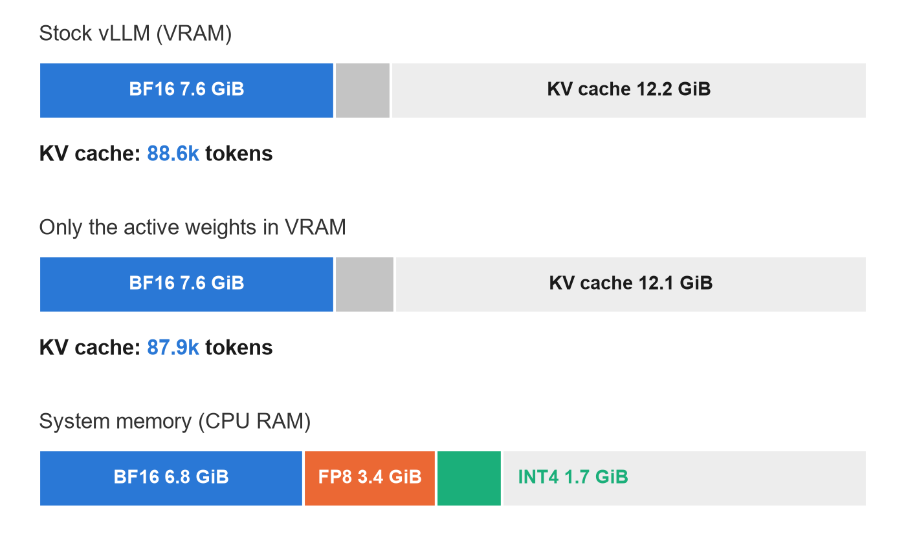
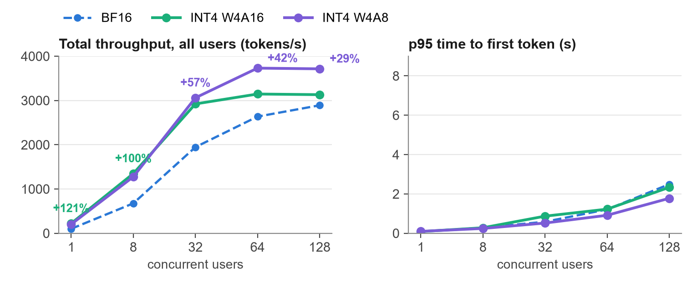
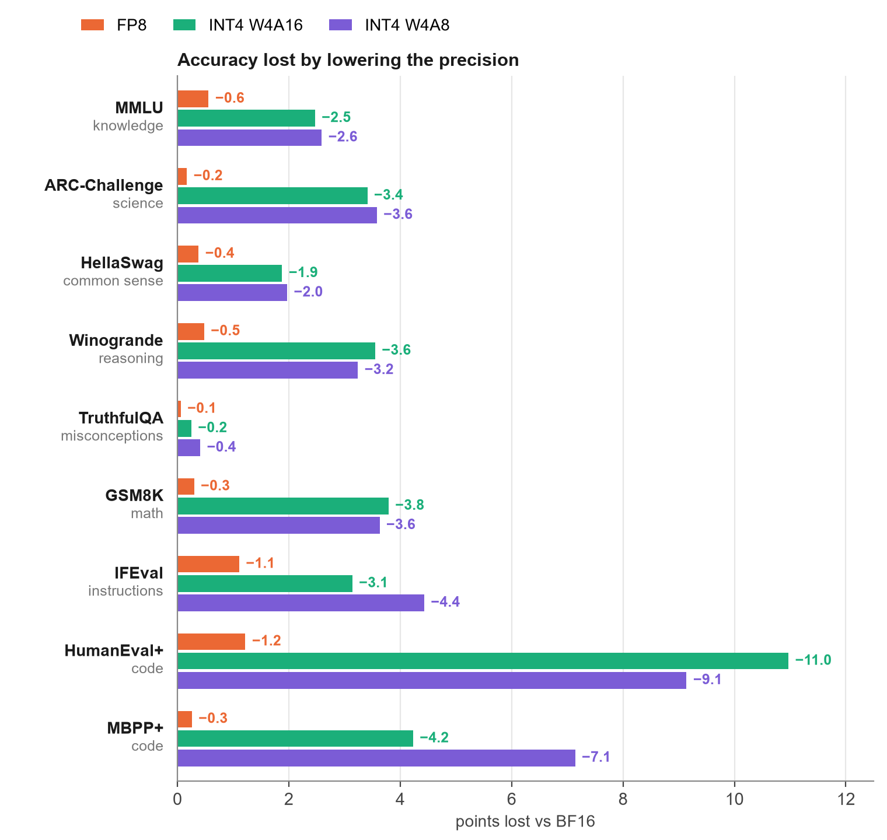
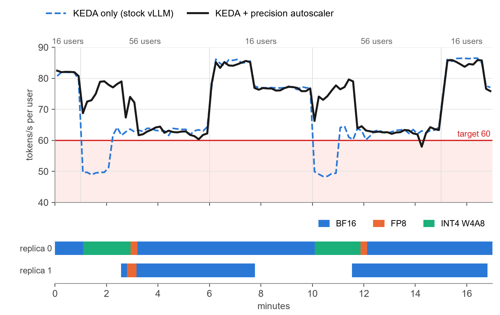

# vllm-precision-autoscaler

A [vLLM](https://github.com/vllm-project/vllm) plugin that switches a running model between
precisions (BF16, FP8, INT4) **while it keeps serving requests**. No restart, no second
replica, no change to vLLM's source.

The plugin only *executes* switches. An outside controller decides *when*, through a small
HTTP API. The included controller lowers the precision when a replica has more users than
it can serve at full precision, and raises it again when the load drops, so a GPU can
absorb a traffic burst instead of letting per-user speed fall.

## How it works



- **Only the active precision lives in VRAM.** Every linear layer gets one GPU region,
  sized for its BF16 weights. Every precision version of every layer is built once at
  startup from the BF16 weights and kept in pinned system RAM (about 12 GiB for Qwen3-4B
  with BF16 + FP8 + INT4). The KV cache keeps almost all of its space (−1% vs stock vLLM).
- **Switching = copying.** When a new precision is requested, the layers are copied into
  their GPU regions on a side CUDA stream while vLLM keeps serving. A full switch takes
  0.2–1 s on an RTX 4090. During it, some layers already run the new precision.
- **One set of CUDA graphs per precision.** A recorded CUDA graph stores which kernels run
  on which addresses, not the data. Because the weights never move, the plugin records every
  decode graph once per precision at startup and replays the set that matches what the
  memory holds. This patches vLLM's model runner V2 at runtime, so **the plugin is tied to
  vLLM v0.32.0**.
- **Kernels are vLLM's own.** No custom CUDA code.

| Version | Weights | Math | Kernel |
|---|---|---|---|
| `high` | BF16 / FP16 (the loaded model) | 16-bit | cuBLAS |
| `fp8` | FP8 E4M3, per-channel scales | FP8 (W8A8) | CUTLASS scaled-mm |
| `int4` | INT4, round-to-nearest, groups of 128 | 16-bit (W4A16) | Marlin |
| `int4a8` | same INT4 weights | FP8 (W4A8) | Marlin, SM89 (RTX 4090, L40S) |

## Results

Qwen3-4B on one RTX 4090 (24 GB), vLLM v0.32.0, 512 input / 256 output tokens.



| Total tokens/s | 1 user | 8 | 32 | 64 | 128 |
|---|---|---|---|---|---|
| BF16 | 101 | 675 | 1,946 | 2,635 | 2,890 |
| FP8 | 127 | 858 | 2,301 | 3,051 | 3,322 |
| INT4 (W4A16) | 222 | 1,348 | 2,922 | 3,145 | 3,131 |
| INT4 (W4A8) | 203 | 1,276 | 3,060 | 3,730 | 3,715 |

**Accuracy cost**, nine lm-evaluation-harness tasks on the same model and GPU. FP8 kept
99.3% of the BF16 score on average, INT4 about 94% (W4A16 94.5%, W4A8 94.2%). Code
generation lost the most. The loss depends heavily on the model and the task, so test it
on your own workload.



### Proof of concept: KEDA on Kubernetes

Two RTX 4090 replicas behind KEDA, load moving between 16 and 56 parallel users, target
60 tokens/s per user. While KEDA starts the second replica, plain vLLM drops to about
50 tokens/s per user. With the plugin, the running replica switches to INT4 W4A8 and stays
above the target until the new replica serves, then goes back to BF16. Over the whole run,
plain KEDA spent 130 s below the target (160 s in a second run), KEDA with the plugin 10 s
(10 s).



Setup, manifests and the scripts to reproduce it: [`poc/k8s-keda`](poc/k8s-keda).

## Requirements

- vLLM **v0.32.0** (tested with the `vllm/vllm-openai:v0.32.0-cu129` image)
- an FP8-capable NVIDIA GPU (compute capability ≥ 8.9: RTX 4090, L40S, H100, RTX 5090, …);
  `int4a8` needs SM89 or SM12x
- a BF16 or FP16 model, and pinned system RAM for the extra versions
  (about 1.75 × the BF16 weight size for BF16 + FP8 + INT4)

## Install

```bash
pip install --no-deps "git+https://github.com/czinegeroland/vllm-precision-autoscaler@main#subdirectory=plugin"
```

`--no-deps` leaves your vLLM install untouched (the plugin declares no dependencies). vLLM
finds the plugin through its `vllm.general_plugins` entry point.

## Run

```bash
export VLLM_PLUGINS=precision_autoscaler,precision_autoscaler_api
export VPA_FORMAT=swap VPA_VERSIONS=high,fp8,int4a8 VPA_MODE=high

vllm serve Qwen/Qwen3-4B \
  --quantization precision_autoscaler \
  --compilation-config '{"cudagraph_mode": "FULL_DECODE_ONLY"}'
```

`VLLM_PLUGINS` is needed because vLLM loads endpoint plugins only when they are allowlisted,
and the allowlist then applies to all plugins, so both names are listed.

### Control API

| Request | Effect |
|---|---|
| `GET /v1/precision` | active version, all configured versions (bits, method, RAM used), migration state, recent migrations |
| `POST /v1/precision` `{"version": "fp8"}` | start switching to that version (`high`, `fp8`, `int4`, `int4a8`; must be in `VPA_VERSIONS`); returns 400 otherwise |
| `GET /v1/precision/metrics` | the same state in Prometheus format (`vpa_active_bits`, `vpa_target_bits`, migrations, …) |

```bash
curl -s localhost:8000/v1/precision
curl -s localhost:8000/v1/precision -H 'Content-Type: application/json' -d '{"version":"fp8"}'
```

### Reference controller

[`controller/precision_controller.py`](controller/precision_controller.py) (Python, stdlib
only; PyYAML for the config file) reads `vllm:num_requests_running + waiting` from vLLM's
`/metrics`, steps down a precision ladder when the user count crosses the configured
thresholds, and steps back up after the load has stayed low for a while. An optional guard
steps down one more level when per-user tokens/s stays below a target. Every decision is
logged as one JSON line, and the controller's state is served for Prometheus on
`--metrics-port` (9101).

```bash
python3 controller/precision_controller.py --config controller/config.example.yaml --url http://localhost:8000
```

```yaml
ladder: [high, fp8, int4]   # best quality first
step_down_users: [24, 40]   # high -> fp8 at >= 24 users, fp8 -> int4 at >= 40
step_up_users:   [16, 32]   # back up at <= 32 and <= 16 users
hold_down_s: 2              # react fast to rising load
hold_up_s: 20               # return to higher quality only when load stays low
dwell_s: 10                 # at least this long between switches
slo_tok_s: 60               # guard: per-user tokens/s target (0 = off)
```

Any other service (a Kubernetes operator, a .NET service, …) can use the same API instead.

### Settings (environment variables)

| Variable | Default | Meaning |
|---|---|---|
| `VPA_FORMAT` | `dual` | `swap` (recommended): one version in VRAM, all in RAM. `dual`: BF16 and FP8 both in VRAM (+50% weight memory), FP8 chosen per step by step size |
| `VPA_VERSIONS` | `high,fp8` | swap: versions built at startup and kept in RAM (`high` is always included) |
| `VPA_MODE` | `auto` | swap: the version to start in (`high`, `fp8`, …). dual: `high`, `fp8`, `auto` or `dial` |
| `VPA_SWAP_POLICY` | `external` | swap: `external` (switch only through the API) or `hysteresis` (built-in policy, opt-in) |
| `VPA_SWAP_GRAPHS` | `1` | swap: record one CUDA graph set per version (needs `FULL_DECODE_ONLY` or `FULL`) |
| `VPA_SWAP_SLOTS` / `VPA_SWAP_STAGING_MIB` | `4` / – | swap: staging buffers for the background copies |
| `VPA_THRESHOLD` | `256` | dual + auto: tokens per step above which FP8 is used |
| `VPA_COUNT` | `0` | `1` = exact GPU-side counters of calls and tokens per precision |

### Known caveats

- vLLM's on-disk compile cache key ignores the `VPA_*` settings. Set
  `VLLM_DISABLE_COMPILE_CACHE=1`, or use a separate `VLLM_CACHE_ROOT`, when you change
  `VPA_FORMAT` or `VPA_VERSIONS` on one machine.
- `swap` needs `cudagraph_mode` `FULL_DECODE_ONLY`, `FULL` or `NONE` (piecewise graphs would
  freeze one precision). Prefill steps run without graphs.
- A new replica starts slower with the plugin (about 77 s instead of 52 s for Qwen3-4B on a
  warm 4090), because it builds the extra versions and records the extra graph sets.
- INT4 weights are made with plain round-to-nearest, no calibration.

## Repository layout

```text
plugin/          the pip-installable plugin (vllm_precision_autoscaler) and its tests
controller/      reference controller (decides when to switch)
bench/           load sweep, accuracy (lm-evaluation-harness), autoscaling run, Prometheus export
deploy/          RunPod helpers (rp.py, pod.sh), pod setup, Prometheus + Grafana for one node
poc/k8s-keda/    proof of concept: KEDA autoscaling on Kubernetes with the plugin
docs/images/     the charts in this README
```

## Tests

```bash
python -m unittest discover -s plugin/tests -p test_policy.py   # anywhere, no GPU
python -m pytest -q plugin/tests/test_controller.py             # anywhere, no GPU
cd plugin && python -m pytest -q tests/gpu                      # needs vLLM v0.32.0 + an FP8 GPU
```

## License

Apache-2.0.
