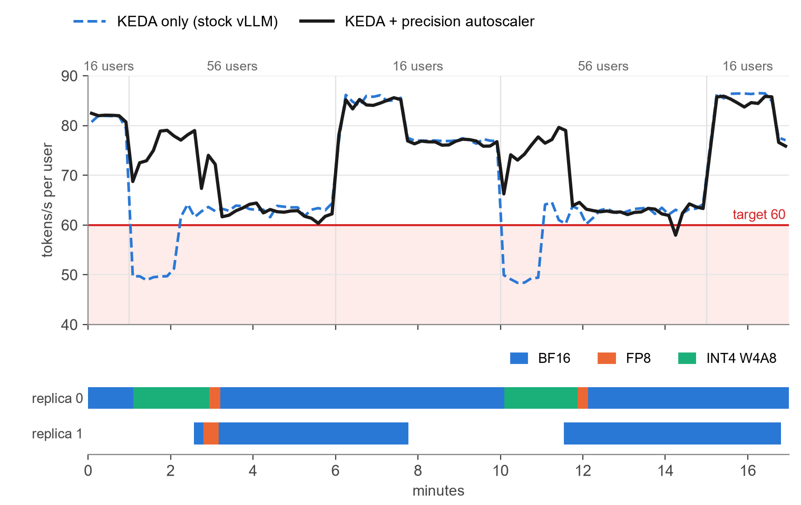
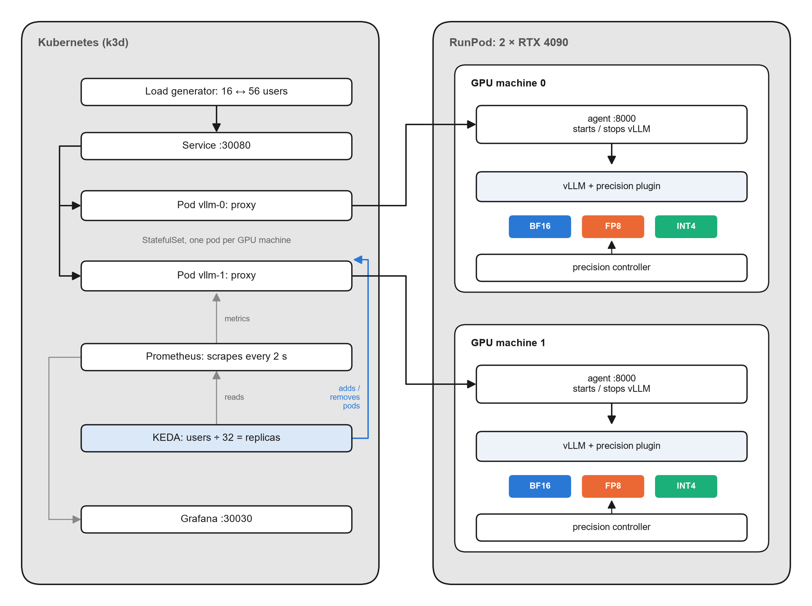

# Proof of concept: KEDA + precision autoscaler on Kubernetes

Question: while KEDA starts a new vLLM replica during a traffic burst, can the precision
plugin keep the users on the replicas that are already running above a per-user speed
target?

- **Scenario 1, KEDA only:** stock vLLM (BF16). A burst arrives, KEDA adds a replica, and
  the users wait out its cold start on the replica that is already running.
- **Scenario 2, KEDA + precision autoscaler:** same burst, same KEDA. The running replica
  drops to FP8 / INT4 W4A8 while the new one starts, then returns to BF16 once the new
  replica takes its share.

## Result

Two RTX 4090s on RunPod, Qwen3-4B, load 16 → 56 → 16 → 56 → 16 parallel users, target
60 tokens/s per user. Two runs of both scenarios.



| | KEDA only | KEDA + plugin |
|---|---|---|
| Time below 60 tokens/s per user (run 1 / run 2) | 130 s / 160 s | 10 s / 10 s |
| Per-user speed while the 2nd replica starts (median) | 49.7 / 49.1 tokens/s | 76.5 / 74.2 tokens/s |
| Requests completed in 17 min | 9,249 / 9,241 | 9,668 / 9,740 |
| Warm cold start of a replica (median) | 52 s | 77 s |

## Setup



- Kubernetes can't run inside a RunPod pod (unprivileged container), so the cluster runs
  locally in k3d, and each replica `vllm-N` owns RunPod GPU machine N.
- The GPU machines stay up (image pulled, model on disk). When KEDA schedules `vllm-N`, its
  proxy asks agent N to start vLLM. The pod becomes Ready only when vLLM answers, so the
  cold start is the real one: model load, building the precision versions, CUDA graph
  capture.
- KEDA scales on **users** (requests running + waiting over all replicas, averaged over
  10 s), one replica per 32 users: BF16 holds 60 tokens/s per user up to about 32 users on
  one 4090. It must not scale on tokens/s per user: the plugin raises that, and KEDA would
  stop adding replicas.
- The controller on each machine ([`controller.yaml`](controller.yaml)) lowers the
  precision only when its replica has clearly more than 32 users (FP8 at 40, INT4 W4A8 at
  52) and returns to BF16 at 32.

## Files

| File | Role |
|---|---|
| `run.sh` | every step of a run (below) |
| `run_all.sh` | unattended run: get machines, prewarm, both scenarios, save, terminate |
| `acquire.sh` | get N verified RunPod machines (GPU name and memory check, CUDA test), set them up |
| `pod_setup.sh` | on each RunPod machine: install the plugin from the pushed checkout, model, agent |
| `agent.py` | on each GPU machine: start/stop vLLM, cold start timing, metrics, traffic |
| `proxy.py` | one Kubernetes replica: start its machine's vLLM, Ready when it serves, drain + stop on scale-down |
| `controller.yaml` | precision controller settings for one replica |
| `manifests/vllm.yaml` | StatefulSet, Service (NodePort 30080), KEDA ScaledObject |
| `manifests/monitoring.yaml` | Prometheus (30090) and Grafana (30030) |
| `manifests/fake-backends.yaml`, `fake_vllm.py` | local test without GPUs (the 4090's measured speeds) |
| `make_dashboard.py` | Grafana dashboard `grafana/k8s-burst.json` |
| `burst_load.py` | the load (one pool of closed-loop users, a new connection per request) |
| `k8s_export.py` | Prometheus series of a run → `<name>.prom.json` |
| `plot_k8s_burst.py` | chart + numbers |
| `gpu_check.sh` | on a GPU type that is new to the plugin: GPU tests and a load sweep |

## Run it

Needs Docker, kubectl, Git Bash (or any bash), a RunPod API key in
`deploy/runpod/.runpod_api_key` and an SSH key in `deploy/runpod/.keys/vpa_ed25519`.
Everything runs from the repo root.

```bash
bash poc/k8s-keda/run.sh tools          # k3d into poc/k8s-keda/.bin
bash poc/k8s-keda/run.sh cluster-up     # k3d, KEDA, Prometheus, Grafana, proxy image (~2 min)
N=2 bash poc/k8s-keda/acquire.sh        # 2 verified RTX 4090 machines, set up (~10 min)
N=2 bash poc/k8s-keda/run.sh prewarm    # start/stop each mode twice: fills compile caches
N=2 MODE=stock bash poc/k8s-keda/run.sh vllm-up
N=2 PHASES=16:60,56:300,16:240,56:300,16:120 bash poc/k8s-keda/run.sh scenario stock  keda-only
N=2 PHASES=16:60,56:300,16:240,56:300,16:120 bash poc/k8s-keda/run.sh scenario plugin keda-plugin
N=2 bash poc/k8s-keda/run.sh save       # Prometheus export + snapshot, logs, configs
bash poc/k8s-keda/run.sh pods-terminate # do not forget
bash poc/k8s-keda/run.sh report         # results/k8s_burst/k8s_burst.png + numbers
bash poc/k8s-keda/run.sh cluster-down
```

Or all of it unattended: `N=2 bash poc/k8s-keda/run_all.sh`.

- Grafana during the run: http://localhost:30030 (dashboard "vLLM on Kubernetes").
- Load shape `PHASES` is users:seconds. Each burst must last clearly longer than a cold
  start (`prewarm` prints them), or there is nothing to bridge.
- Cost: 2 × RTX 4090 at $0.34–0.89/h each. Setup, prewarm and both scenarios take about an
  hour. Each machine stops itself after `MAX_HOURS` (default 4) as a safety net.

## Local test (no GPUs, free)

```bash
bash poc/k8s-keda/run.sh cluster-up
COLD_START=40 bash poc/k8s-keda/run.sh fake-up
bash poc/k8s-keda/run.sh vllm-up
OUT=results/k8s_burst_fake PHASES=16:30,56:120,16:90 bash poc/k8s-keda/run.sh scenario stock keda-only
OUT=results/k8s_burst_fake PHASES=16:30,56:120,16:90 bash poc/k8s-keda/run.sh scenario plugin keda-plugin
OUT=results/k8s_burst_fake bash poc/k8s-keda/run.sh report
```

The fake machines generate tokens at the speeds measured on the 4090 (`fake_vllm.py`), so
the local chart shows the shape of the real one. Only the real run gives numbers worth
quoting.

## Notes

- Routing: the Service picks a replica per connection, so `burst_load.py` opens a new
  connection per request (otherwise all traffic stays on the first replica).
- Before each scenario, `run.sh scenario` pauses KEDA at 1 replica, stops vLLM on the other
  machines, restarts `vllm-0` in the scenario's mode and only then resumes KEDA.
- Compile caches: one per mode (`VLLM_CACHE_ROOT=/workspace/vllm-cache/<mode>`), because
  vLLM's cache key ignores the plugin's `VPA_*` settings.
- `burst_load.py` counts streamed events, not tokens. vLLM can merge several tokens into one
  event when the reader falls behind, so `plot_k8s_burst.py` counts a request as complete
  when it returned HTTP 200 and the stream ended without an error.
